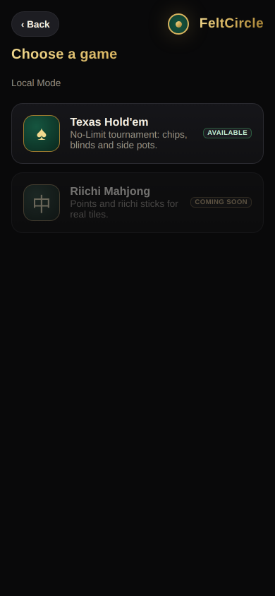
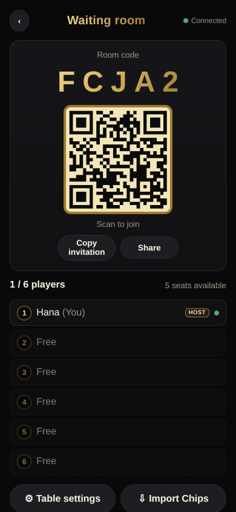
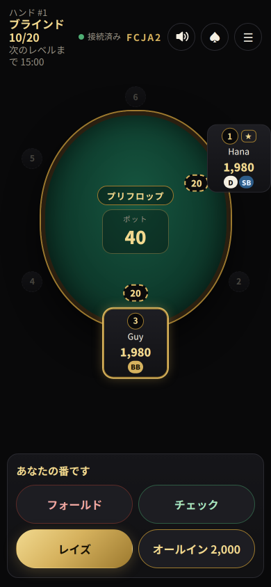
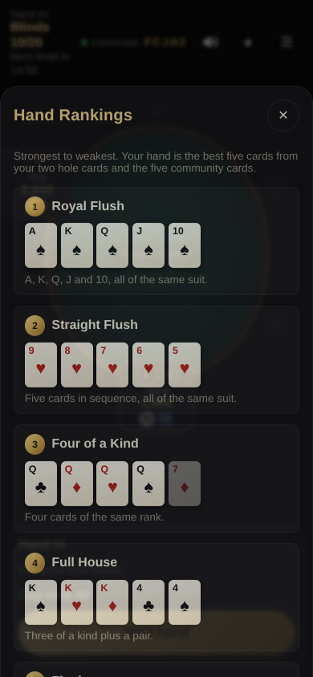
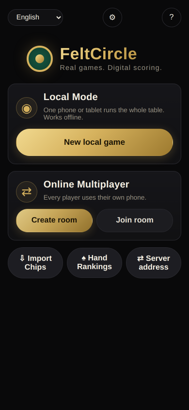
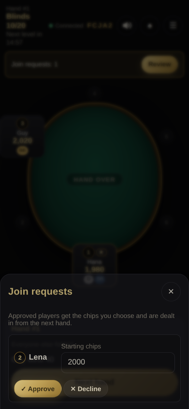
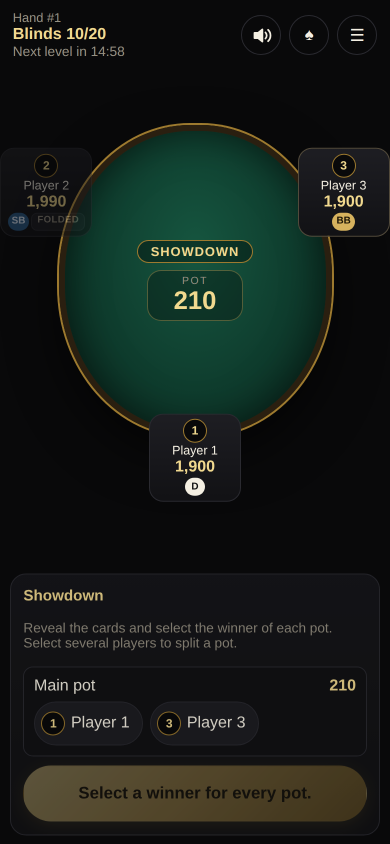
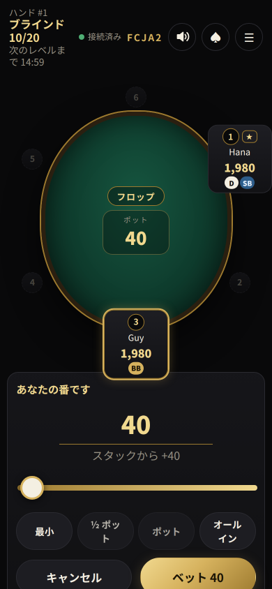
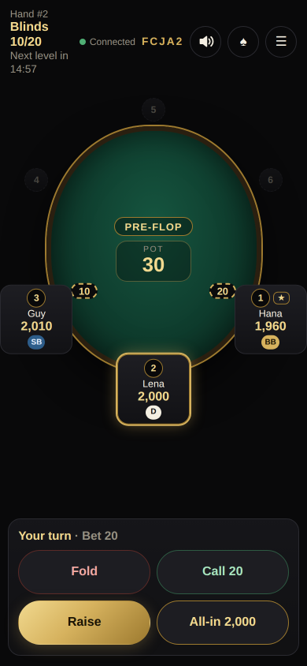

# FeltCircle

**Real games. Digital scoring.**

FeltCircle is a free, self-hostable scorekeeper for in-person tabletop games. The first game is No-Limit Texas Hold'em
(Riichi Mahjong is planned). Everyone sits around a real table with a real deck. Phones replace the physical chips:
stacks, blinds, bets, pots and side pots are tracked by the app.

<p align="center">
  
  
  
  
</p>

- **No virtual cards.** The app never deals, shows or evaluates cards. Players reveal their real cards and the host taps who won each pot.
- **No real money.** Chips have no value and cannot be bought or cashed out.
- **No accounts.** Nobody signs up. A five-character room code and a QR code are enough to join.

## Two ways to play

| | Local Mode | Online Multiplayer |
|---|---|---|
| Devices | One phone/tablet passed around or placed on the table | Every player uses their own phone |
| Server | None (static files, works offline as a PWA) | Node.js server on a VPS **or** Cloudflare Workers + Durable Objects |
| Storage | Browser (IndexedDB/localStorage) | Server-side SQLite (authoritative) |

Both modes use the same rules engine, and chips can move between them with **chip export/import**: a short text such as `FC1 1=2500 2=1750 3=3200 4=550 T=8000`.

## Features

- Strict NLHE betting: minimum raises, incomplete all-in raises that do not reopen action, uncalled bet refunds, heads-up blind rules, a moving button, multiple side pots, and odd chips paid clockwise from the button. Chips are conserved: totals are checked by fuzz tests.
- Tournament structure: 2,000 starting chips and 10/20 blinds by default (all configurable). Blinds go up every 15 minutes **or** as players are eliminated, whichever comes first.
- The betting slider has Min / ½ Pot / Pot / All-in presets. A bet is only made when confirmed, never while dragging.
- Game selection: the same catalog in Local Mode and online. Texas Hold'em is available; Riichi Mahjong is shown as *Coming Soon*, and backends reject it.
- Simple room setup: player count, starting chips and blinds up front. *Advanced settings* (collapsed) holds blind progression (Hybrid by default, Time, Players or Fixed) and the level interval. The big blind must be larger than the small blind.
- Pre-actions: Fold, Check/Fold, Call Any, Clear.
- Circular seat selection: seats sit around an oval table (seat 1 at the top, clockwise), sized for phones and desktop at every table size from 2 to 10. When the game starts, the server closes gaps between seats once (waiting-room seats 1, 2, 4, 6 play as 1, 2, 3, 4), keeping the clockwise order, the host, the chosen dealer and everyone's reconnect link.
- Late joining: after the game starts, newcomers request a free seat. The host approves with the chips they choose (default 2,000) or declines, and the player is dealt in from the next hand. The host can enlarge the table up to 10 seats.
- Flexible chips: no fixed chip supply. Between hands the host can correct or top up any balance, and every change is recorded in the history.
- Showdown claims: players tap **I Won!** (synced, withdrawable, only for pots they're in) or **I Lost / Muck**. Claims never move chips; the host confirms every pot.
- Host tools: start, pause, confirm each street after dealing, choose showdown winners per pot, undo, change blinds, adjust chips, approve join requests, transfer host, force-fold offline players, end the game, delete the room.
- Disconnects: a player who has been offline for 30 seconds is auto-folded on their turn (never auto-checked). This runs on the server, so it works even when nobody has the app open. All-in players are never folded. If the host is offline, any seated player can claim host.
- Sound effects for blinds, bets, calls, raises, all-ins, folds, checks, wins and completed hands. They play only for confirmed events, never repeat after a reconnect, and can be muted or turned down per device. All sounds are original and bundled.
- A **Hand Rankings** guide (10 categories with example cards, plus kickers, ties, split pots, ace-high/low straights and more), available offline in every language. It is a reference only: the app never reads or evaluates cards.
- Rooms persist across server restarts and are deleted 24 hours after the last meaningful activity.
- Ten languages: English, 简体中文, 繁體中文, 日本語, 한국어, Français, Deutsch, Español, Português, Русский (react-i18next, bundled with the app). Each player picks their own language, and the room sets the default.
- A premium mobile-first black/gold/green interface. It installs as a PWA, keeps the screen awake during play, and vibrates on your turn.

## Quick start (development)

Requires Node.js **22.13+** (uses the built-in `node:sqlite`).

```bash
npm install
npm run dev:server   # backend on http://127.0.0.1:8787
npm run dev          # web app on http://localhost:5173 (proxies /api and /ws to the backend)
```

Open the printed URL on your computer, or on a phone on the same network with `npm run dev -w @feltcircle/web -- --host`.

```bash
npm run check        # typecheck + all tests + production build
```

## Deploying

Pick one. Each option takes a few minutes. Full instructions are in **[docs/DEPLOYMENT.md](docs/DEPLOYMENT.md)**.

1. **Static only (Local Mode):** upload `apps/web/dist` to GitHub Pages, Cloudflare Pages, Netlify or any web server.
2. **VPS with Docker:** `docker compose up -d --build`, then point Nginx/OpenResty/Caddy at `127.0.0.1:8787` (examples in `deploy/nginx` and `deploy/openresty`). Works on x86-64 and ARM64.
3. **VPS without Docker:** a single bundled `server.mjs` with a systemd unit.
4. **Cloudflare:** `npm run deploy:cloudflare` deploys the web app, Worker and Durable Objects together.

The web app and backend share one origin by default: `/api/capabilities`, `/api/rooms` and the WebSocket at `/ws`. Invite links look like `https://example.com/join/CFW27`. The web app detects automatically whether a multiplayer backend is available (`GET /api/capabilities`). If none is found, Local Mode still works, and Online Multiplayer is shown as unavailable with a Retry button.

If you deploy with an AI coding assistant, point it at **[docs/AI_DEPLOYMENT.md](docs/AI_DEPLOYMENT.md)**.

There is **no official public server**. Nothing in this repository refers to a particular domain, and no account, API key or external service is required.

## Screenshots

| Home | Waiting room | Late join approval | Showdown (Local Mode) |
|---|---|---|---|
|  |  |  |  |

| Bet slider | Late joiner seated | Hand Rankings | Game selection |
|---|---|---|---|
|  |  |  |  |

The screenshots are produced by the browser end-to-end test (`E2E_SHOTS=<dir> npx vitest run tests/e2e.test.ts`).

## Repository layout

```
packages/
  poker-engine/    Pure NLHE betting/pot/blind engine (no I/O)
  chip-export/     Versioned chip export/import format
  game-protocol/   Wire protocol, validation, shared constants
  room-core/       Room state machine + runtime shared by every backend
  game-session/    Client sessions (local and online) used by the web app
  i18n/            Translations (one JSON file per language)
apps/
  web/             React + Vite PWA (static build, identical everywhere)
  server-node/     Node.js backend (HTTP + WebSocket + SQLite)
  server-cloudflare/  Cloudflare Worker + SQLite-backed Durable Objects
tests/             Integration, cross-backend consistency and browser E2E tests
deploy/            Nginx and OpenResty configs, systemd units, backup script
docs/              Architecture, deployment, AI deployment, troubleshooting
```

See **[docs/ARCHITECTURE.md](docs/ARCHITECTURE.md)** for how the pieces fit together.

## Documentation

- [Architecture](docs/ARCHITECTURE.md)
- [Deployment](docs/DEPLOYMENT.md): static hosting, Docker, systemd, Cloudflare, backups, updates
- [Deployment with an AI assistant](docs/AI_DEPLOYMENT.md)
- [Troubleshooting](docs/TROUBLESHOOTING.md)
- [Contributing](CONTRIBUTING.md)

## License

[MIT](LICENSE). FeltCircle's UX was inspired in part by the MIT-licensed PocketPoker project. FeltCircle is an independent implementation and contains no code from it.
